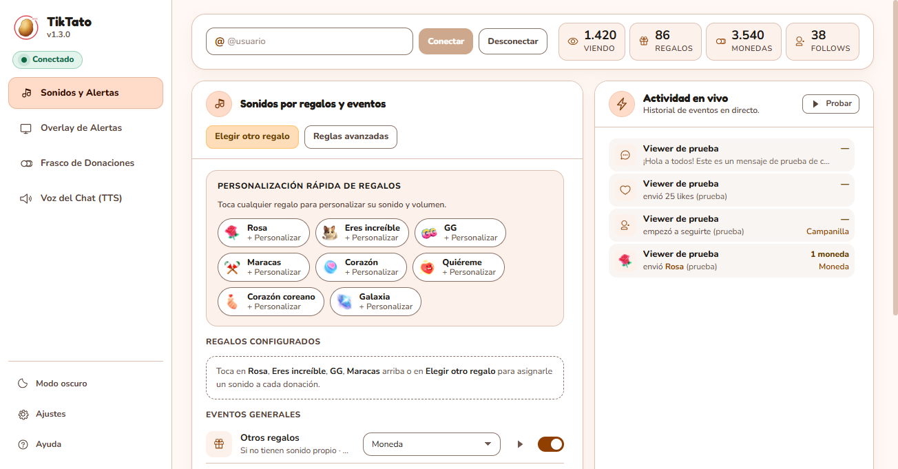
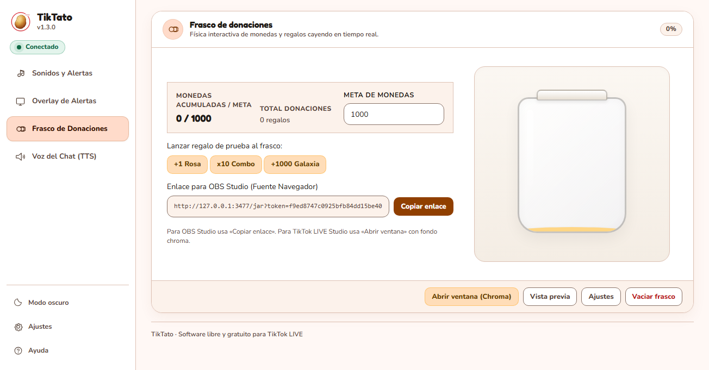

# TikTato

[](https://github.com/alvaro-salort/Tiktato/releases/latest)
[](https://github.com/alvaro-salort/Tiktato/releases)
[](LICENSE)

App de escritorio gratuita y de código abierto para Windows. Conecta tu directo de TikTok LIVE con alertas de sonido, overlays y voz en tiempo real para OBS Studio y TikTok LIVE Studio.

> Proyecto independiente bajo GPLv3, sin afiliación con TikTok. Úsalo solo en directos y cuentas que tengas derecho a gestionar.

## Descargar

- [Instalador de Windows (NSIS, con actualizaciones automáticas)](https://github.com/alvaro-salort/Tiktato/releases/latest)
- [Versión portable para Windows](https://github.com/alvaro-salort/Tiktato/releases/latest)

Requiere Windows 10 u 11 de 64 bits.



## Qué hace

- **Alertas y sonidos:** asigna audios propios (MP3, WAV, OGG, M4A, AAC, FLAC o WEBM hasta 30 MB) o los 6 sonidos integrados a regalos, follows, shares, likes, suscripciones y entradas. Incluye catálogo de regalos según tu región y control de rachas por regalo.
- **Overlay de alertas:** página local transparente con token único para agregar como fuente de navegador en OBS Studio o TikTok LIVE Studio.
- **Frasco de donaciones 2D:** los regalos caen con física (Matter.js) dentro de un frasco SVG con meta, alertas y ranking rotativo de donantes. Se puede usar como enlace de navegador o como ventana dedicada con fondo chroma (verde, azul, magenta, oscuro o transparente) para TikTok LIVE Studio.
- **Voz del chat y regalos (TTS):** usa las voces locales de Windows por defecto y admite Fish Audio con tu propia API key. Trae filtros por rol, atenuación automática de sonidos al hablar (ducking), filtro anti-spam y borrado automático en cola si un moderador elimina el mensaje.
- **Privacidad y apariencia:** las sesiones de TikTok y claves de API se cifran localmente con DPAPI de Windows (`safeStorage`). El tema cambia solo entre claro y oscuro según la hora (oscuro de 20:00 a 07:00) o se fija manualmente.



## Versión portable y actualizaciones

La versión instalada con NSIS (`Tiktato-Setup-*.exe`) se actualiza sola desde GitHub Releases sin pedir permisos de administrador. La portable no puede auto-actualizarse porque Windows bloquea el ejecutable mientras corre.

Si usas la portable en un pendrive, crea una carpeta `tiktato-data` junto al `.exe` para guardar allí la configuración y los sonidos en vez de `%APPDATA%\tiktato`. Las sesiones y claves cifradas con DPAPI dependen de cada PC, así que al cambiar de equipo tendrás que volver a iniciar sesión.

## Desarrollo

Requiere Node.js 22 o superior en Windows 10/11:

```bash
git clone https://github.com/alvaro-salort/Tiktato.git
cd Tiktato
npm install
npm test
npm start
```

Para generar el instalador NSIS y el portable en `dist/`:

```bash
npm run dist
```

## Licencia

[GNU General Public License v3.0](LICENSE).
