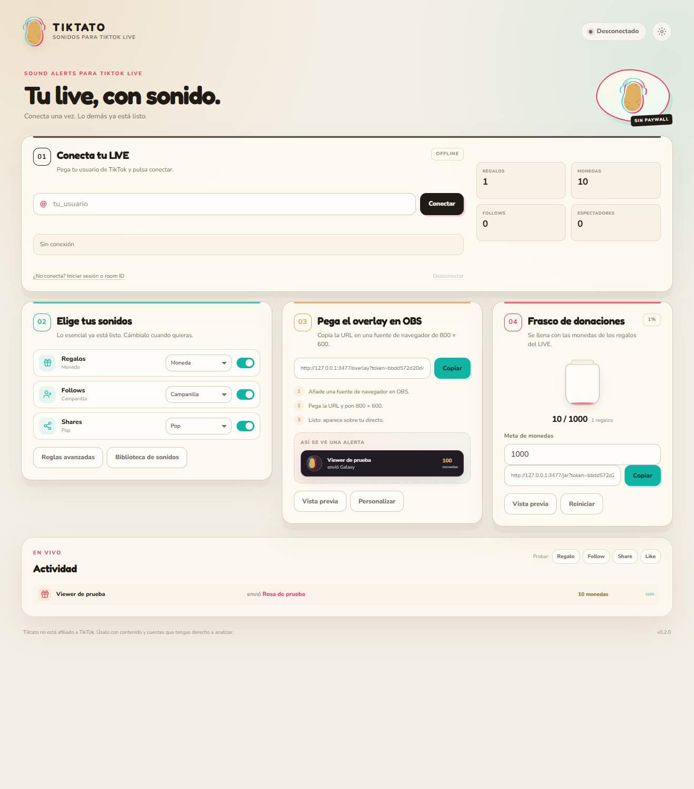
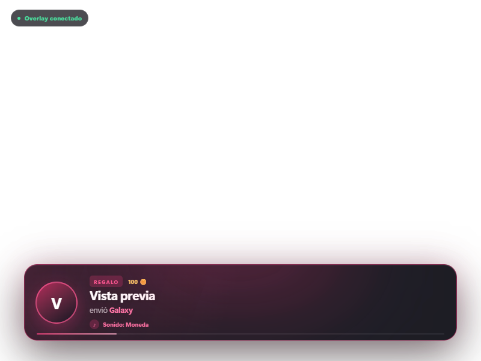
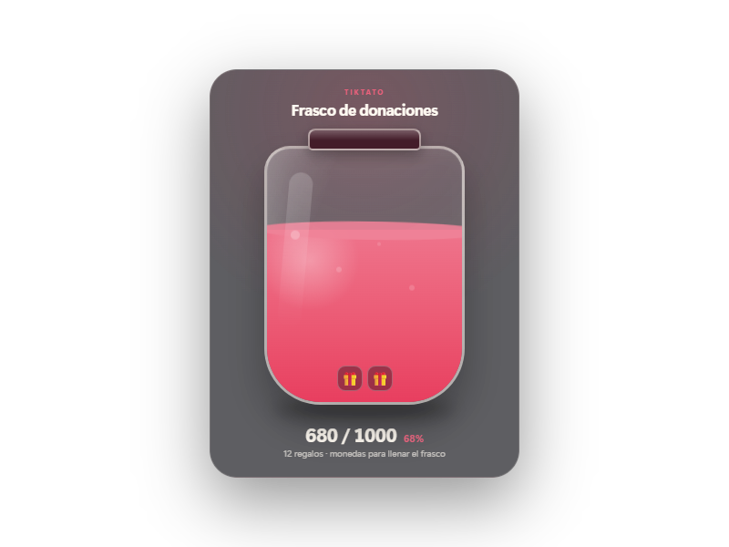
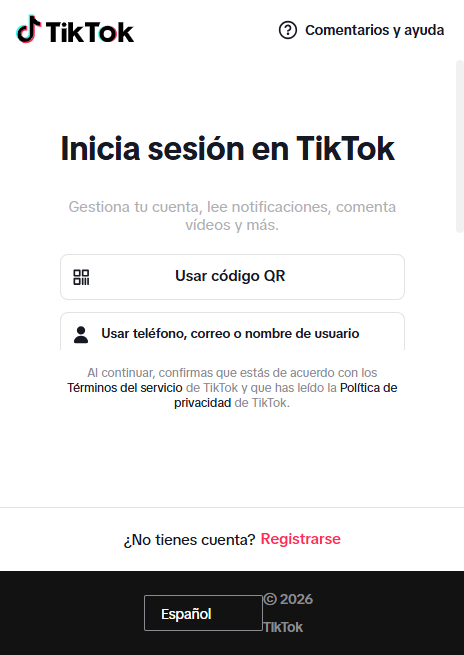

# Tiktato

Sound alerts y overlays para **TikTok LIVE**, sin cuenta, sin suscripción y sin paywall.

Tiktato es una reimplementación local y acotada de la función principal de TikFinity: escuchar eventos de un directo de TikTok y reproducir un sonido cuando alguien envía un regalo, sigue el canal, comparte el directo o da likes. Incluye un overlay para OBS / TikTok LIVE Studio.

> Proyecto independiente. No está afiliado a TikTok ni a TikFinity. Úsalo solo con directos y cuentas que tengas derecho a analizar.

## Descargar

- [Instalador de Windows v0.2.1](https://github.com/alvaro-salort/Tiktato/releases/download/v0.2.1/Tiktato.Setup.0.2.1.exe)
- [Versión portable v0.2.1](https://github.com/alvaro-salort/Tiktato/releases/download/v0.2.1/Tiktato.0.2.1.exe)

También puedes ejecutarlo desde el código con `npm install` y `npm start`.



## Qué incluye

- Conexión directa a un TikTok LIVE por nombre de usuario.
- Reglas por **regalo**, **follow**, **share** y **like**.
- Coincidencia de regalos por nombre, comodines (`*rosa*`) y mínimo de monedas.
- Cooldown por regla y usuario para evitar spam.
- Sonidos incluidos sintetizados (moneda, campanilla, pop, destello, fanfarria, redoble).
- Subida de sonidos propios (MP3, WAV, OGG, M4A, AAC, FLAC, WEBM; máximo 30 MB).
- Overlay transparente para OBS con animación, avatar, imagen del regalo, monedas y nombre del sonido.
- **Frasco de donaciones** que se llena con las monedas de los regalos, con meta configurable, porcentaje y regalos recientes.
- URL de overlay y frasco protegidas con token aleatorio.
- Estadísticas básicas y feed de actividad.
- Pruebas de eventos sin necesidad de estar en directo.
- Inicio de sesión por **código QR** dentro de la app, para salas privadas, +18 o LIVE de prueba.
- Sesión de TikTok guardada cifrada con el llavero de Windows.
- Campo de **roomId manual** para conectar una sala que TikTok no publica en su API.
- Conexión sin Euler Stream, sin claves de API y sin servidor de firma de pago.





## Stack

- Electron 45
- Node.js 22.19+ (recomendado 24 LTS o 26)
- [`piratetok-live-js`](https://github.com/PirateTok/live-js) para los eventos del LIVE, con firma local y sin servidor externo
- `ws` para el canal local entre Electron y el overlay
- HTML, CSS y JavaScript sin framework en la interfaz

## Instalación

```bash
npm install
npm start
```

Para desarrollo con DevTools:

```bash
npm run dev
```

Para ejecutar las pruebas:

```bash
npm test
```

Para generar instaladores de Windows:

```bash
npm run dist
```

Los artefactos quedan en `dist/`.

## Uso rápido

1. Inicia un directo en TikTok desde el móvil o desde LIVE Studio.
2. Abre Tiktato y escribe tu usuario de TikTok, sin la `@`.
3. Pulsa **Conectar LIVE**.
4. Añade reglas en **Reglas de sonido**. Por defecto:
   - Cualquier regalo → Moneda.
   - Follow → Campanilla.
   - Share → Pop.
5. En OBS, añade una **Fuente de navegador** de `800 × 600` y pega la URL que aparece en **Overlay**.
6. Usa los botones **Regalo / Follow / Share / Like** de la sección **Actividad** para comprobar que el overlay y el audio funcionan.

### Si TikTok rechaza la conexión

La conexión es anónima y no usa Euler ni claves de API. Si TikTok no encuentra la sala:

1. Comprueba que el LIVE está iniciado y que han pasado 1–2 minutos.
2. Usa el **uniqueId** exacto de la URL de tu perfil (`tiktok.com/@tu_usuario`), no el nombre visible. Si TikTok responde `user_not_found`, el nombre no coincide.
3. Si es el **LIVE de prueba de Live Studio**, pulsa **Iniciar sesión con TikTok (QR)** en **Sesión opcional**, escanea el código con tu móvil y vuelve a conectar. TikTok no publica esas salas en la API anónima.
4. Si ya tienes el `roomId` de la sala de prueba, pégalo en **Room ID manual** y conecta.
5. Como alternativa manual, copia `sessionid` y `tt-target-idc` de las cookies de una sesión iniciada en el navegador y pégalas en **Sesión opcional**.
6. Desactiva VPN/proxy si TikTok bloquea la región.

> TikTok puede pedir captcha o verificación adicional durante el login QR. Tiktato no recibe ni guarda tu contraseña; solo conserva las cookies de sesión cifradas.



> Las cookies son credenciales. Tiktato las guarda cifradas con `safeStorage` de Electron y no las envía a ningún servidor propio.

## Overlay en OBS

- Fuente: **Navegador**.
- Resolución: `800 × 600` o la que use tu escena.
- URL: la que muestra el panel, con su token.
- Audio: el overlay reproduce el sonido desde el navegador. Activa la salida de audio de la fuente o usa **Controlar audio vía OBS**.
- Si también quieres escuchar los sonidos en el panel, deja activada **Reproducir también en esta ventana**. Si no, desactívala para no duplicar el audio.

El overlay se sirve solo en `127.0.0.1` y el token impide que otra página local se conecte al flujo de eventos.

## Frasco de donaciones

El paso **04** del panel tiene su propia URL de OBS. El frasco se llena con las monedas de los regalos y muestra los últimos regalos recibidos.

- Cambia la **meta de monedas** en el panel.
- Pulsa **Reiniciar** para volver a cero.
- Usa **Vista previa** para abrirlo en el navegador.
- La URL del frasco también está protegida por token.

## Datos y privacidad

- Configuración, sonidos y logs: `%APPDATA%\tiktato` en Windows.
- No hay telemetría ni cuenta propia.
- La app se conecta únicamente a TikTok; no usa un servicio de firma externo.
- El servidor del overlay escucha únicamente en localhost.

Puedes abrir la carpeta desde el pie del panel o borrar `%APPDATA%\tiktato` para empezar de cero.

## Estructura

```text
electron/
  main.cjs             Proceso principal de Electron e IPC
  config.cjs           Configuración, sonidos y validación
  alert-matcher.cjs    Motor de reglas y cooldown
  events.cjs           Normalización de eventos de TikTok
  tiktok-service.cjs   Conexión y eventos del LIVE
  overlay-server.cjs   HTTP + WebSocket local para OBS
  preload.cjs          Puente seguro con la interfaz
renderer/              Panel de control
overlay/               Página transparente para OBS
shared/                Motor de audio compartido
tests/                 Pruebas de reglas, configuración y overlay
```

## Qué no incluye (por ahora)

TikFinity tiene muchas más funciones. Este MVP se centra en lo que pediste:

- No hay TTS, Spotify, chatbot, puntos, niveles, metas, ruletas ni integraciones con Minecraft/GTA.
- No hay login propio ni sincronización en la nube.
- No hay editor visual avanzado de overlays: la personalización actual es título, color, posición, duración e imagen del regalo.
- La conexión real se validó contra un LIVE público. TikTok puede cambiar su API interna; si eso pasa, habrá que actualizar `piratetok-live-js`.

## Licencia

MIT. La capa de conexión [`piratetok-live-js`](https://github.com/PirateTok/live-js) usa licencia 0BSD.

Créditos a [PirateTok](https://github.com/PirateTok/live-js) por la capa de conexión local con TikTok LIVE.
